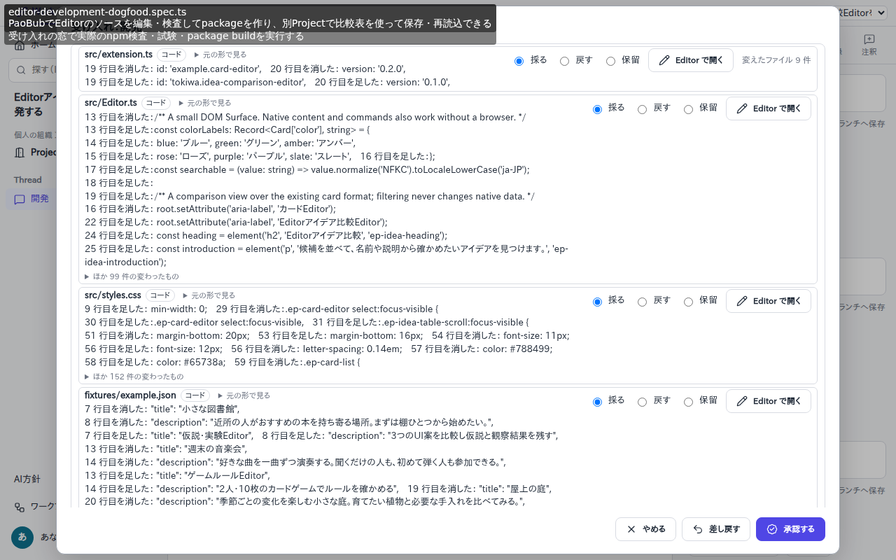
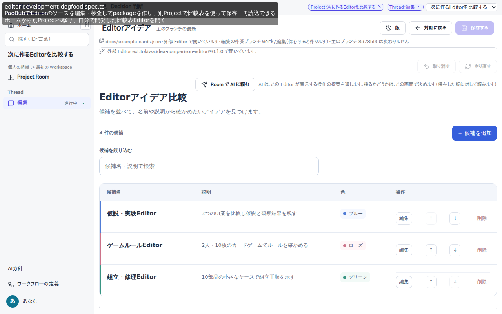

# Editorアイデア比較Editorのdogfood記録

`tokiwa.idea-comparison-editor@0.1.0` は、Open Editor Templateから作った比較表Editorです。`example.cards` / schema 2、編集command、操作提案、Hostの履歴と保存を維持し、候補名・説明・色を表で表示して検索できるようにしました。

## 固定した実装

- 実装commit：`015a9f54651bc550d66b35753a49111bb2ad4020`
- 開始テンプレート：`b759f4cdaa0ec920cba3538c19f06624a7540e12`（ソースtree `96056a6176ddf6b4b1fddda454c163f3cff2d0c0`）
- PaoBub製品ソース：`24799d0c4f926cb99b74456b23e58d82d09f5246`
- package pin（Editor単体CIで確認）：`sha256:0ec6af9ebf988a087a122bbc02c2e220f2ed4b60e16bc9b091c17f83e80bafa9`

PaoBubの開発Projectで変更する9ファイルは、この実装commitとbyte単位で同じ内容です。READMEとCI設定は、独立して再利用・検証するためにこのブランチへ加えた案内です。

## Editor単体の実行結果

[CI run 43833944499](https://github.com/ryo0221/open-editor-template/actions/runs/43833944499) は、上記実装commitで成功しました。

| 検査 | 結果 |
| --- | --- |
| 固定SDKとTypeScript | 成功 |
| 独立したvendor利用 | 成功 |
| 単体テスト | 7ファイル・34件成功 |
| ビルドと独立package読込 | 成功 |
| Chromium・desktop/mobile | 14件成功、失敗0、skip0、flaky0、retry0 |

ブラウザー検証には名前・説明での検索、入力focusの保持、検索による本体・履歴の不変、編集・並べ替え・Undo/Redo・保存・再読込、未確定入力の保護、提案とstale拒否、保存失敗からの復帰、読み取り専用、JSONの書出しと取込みを含みます。モバイルではページ全体が横にはみ出さず、表の枠内でスクロールすることを確認します。

CI artifactの `host-pin.json` は上記pinと一致しました。ローカルビルドだけの自己申告ではなく、別のCI環境でも同じpackageが得られています。

## PaoBub内での開発と利用

一連の操作と入力の完全な記録は、成功した検証commit `106123c77c3749b27ffa1865012b1dd98f9c5a36` の[PaoBub側のdogfood手順](https://github.com/ryo0221/paobub/blob/106123c77c3749b27ffa1865012b1dd98f9c5a36/tests/editor-development-dogfood.md)と[受入ケース](https://github.com/ryo0221/paobub/blob/106123c77c3749b27ffa1865012b1dd98f9c5a36/tests/e2e/editor-development-dogfood.spec.ts)にあります。

[CI run 43834957032](https://github.com/ryo0221/paobub/actions/runs/43834957032)で、PaoBub側の受入ケースは**5件成功・失敗0・skip0・flaky0・retry0**でした。新しい開発・利用の通しケースは1.4分で成功しています。

| 工程 | 成功した内容 |
| --- | --- |
| PaoBubでソースを編集・保存 | 準備した9ファイルの変更を実CodeEditorへ入力し、既存の保存APIから作業ブランチへGit保存 |
| 受け入れgateで実行 | `npm ci`、固定SDK・TypeScript検査、34件のテスト、`build:extension`、`verify:package`を実行して成功 |
| 生成物を導入 | gateの作業場所に生成されたpackageを回収し、Host運用者の手順としてpackage配置と信頼するpinの登録を実施 |
| 別Projectで利用 | 新Editorの比較表を開き、候補名での絞り込み、候補の編集、HostのUndo/Redoを確認 |
| 成果物を保存・再読込 | PaoBubのGit保存後に開き直し、編集結果が維持されることを確認 |

PaoBubの開発Projectで保存したコードを実gateでビルドし、その生成物を利用Projectへ渡す経路を通しました。

この画像は受け入れ画面の差分部分です。gateの成功ログと対象commitは、下記のprovenanceに記録されています。

### 実施した範囲

開発は、PaoBubの人による手編集経路をPlaywrightで操作したものです。用意したソース変更をコード欄へ入力しており、実AIによる自然言語からのコード生成や応答品質は試していません。検査・ビルドはPaoBubの既存local executorで実行し、remote Runnerは使用していません。

Hostへのpackage配置と信頼登録は運用者側の設定です。新packageをインストールして信頼するGUIはこの版のPaoBubにはなく、UI内だけで全工程を完結したとは扱いません。

開発Projectと利用Projectは、GitHub Actionsの隔離されたCI環境に作成した実Projectです。実PaoBubのAPI・画面・Git保存・package読込を使用していますが、利用者が普段使っている永続Projectや共用クラウド環境へ導入した結果ではありません。

### 初回の準備失敗と修正

初回の[CI run 43833732094](https://github.com/ryo0221/paobub/actions/runs/43833732094)は、開発Projectの定義で工程の`acceptance`を空にしていたため、定義の検査に拒否されて準備段階で失敗しました。これを成功した実証として数えていません。

人が確認する条件を1件追加して定義の契約を満たし、上記runで同じ開発・利用の通しケースを再実行して成功しました。追加した条件の`checkedBy`は`人`であり、AI verifierを呼ぶための条件にはしていません。コード保存、実gate、生成物の導入、別Projectでの編集・保存の確認は維持しています。

## 回収した証拠の照合

[実行時のprovenance](dogfood/provenance.json)を回収し、次を照合しました。

| 記録 | 値 |
| --- | --- |
| 開発Projectのbuild対象commit | `7677a2dc29ae8b313786430b07a0d0889465eee5` |
| 開発Projectのsource tree | `452a87b5d0bd98d33babb19f0b0d421f97445507` |
| 利用Projectの保存commit | `5c90bec4a71f978d1bbbc71e0ba5c82f25b550c2` |
| package pin | `sha256:0ec6af9ebf988a087a122bbc02c2e220f2ed4b60e16bc9b091c17f83e80bafa9` |
| 生成package JSONのSHA-256 | `d15b36c31a44d0ab0cb8012d2a5030f7c9a04ee4e2e5e18e63d9001d621572bc` |
| 対象2ProjectのAI呼出し | 0件 |
| 連続動画 | 1280×800、79.92秒 |

9回のUI保存を確認し、build後もworktreeのHEAD・全tracked file・indexがbuild対象commitと一致していました。生成物のコピー前後のbytes、Hostの信頼登録pin、利用Projectのbinding、実際にロードされたpinも一致しています。再読込した成果物全文と3つの候補IDを照合しました。開発Threadの承認・mainへのmergeは実施していません。

成功runの`editor-development-dogfood` artifactに元のWebM動画、Playwright trace、実際の開発ソースarchive、生成package一式があります。共有用MP4は元の79.92秒をカットせずH.264に変換したものです。工程名と操作マーカーはPlaywrightの標準録画overlayです。
