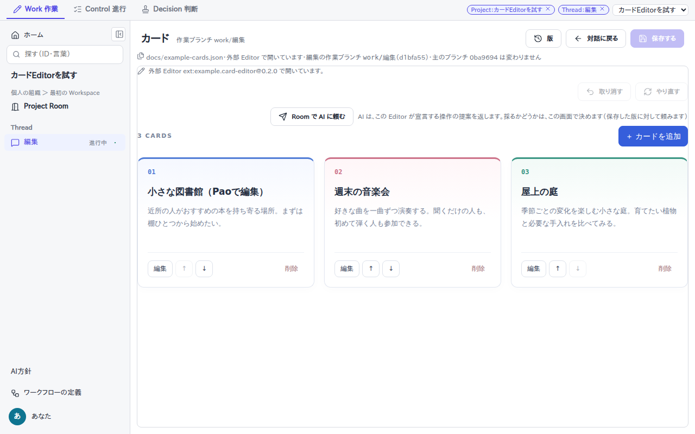
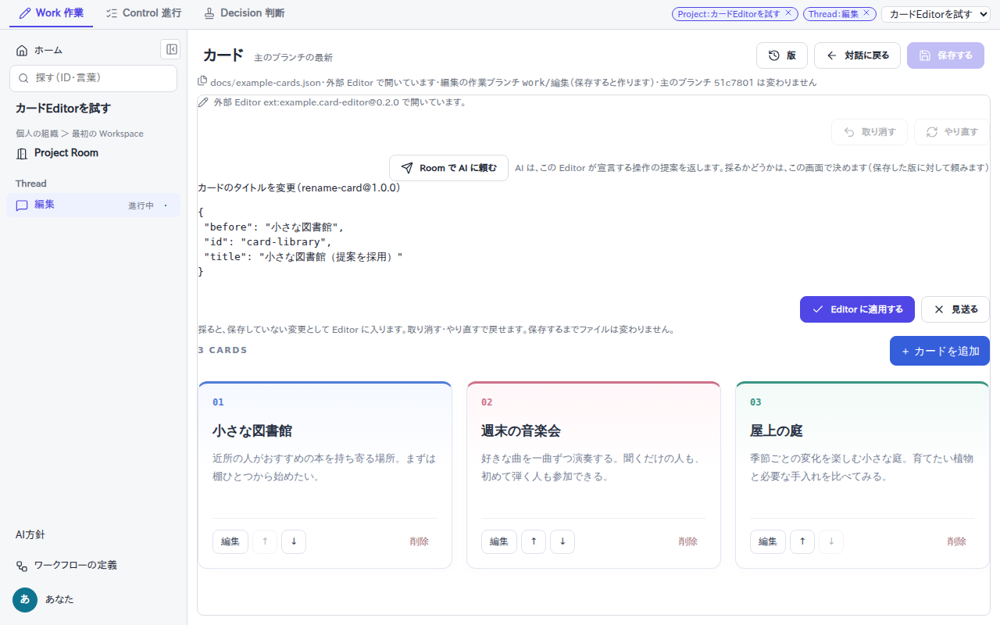

# 検証記録

## 0.3.1 — 確かめの実行系（DOM・Intl・TextEncoder・crypto が無い所）で読み込める

確認日: 2026-11-22。SDK の固定先を公開 commit `c5dcc2b70a6e8fc2de1c77e02d9f9855037803dd`（open-editor-platform #63）へ移した。この版で editor-core は、`Intl.Segmenter` を読み込みのときに作らず、使うときに作る。これにより、Host が受け入れの前に entry を JS の言語の組込みだけの実行系（QuickJS）で読み込んで `validate` を呼んでも、「確かめられない」にならない。固定先は 39 upstream files（`editor-core/src/graphemes.ts` が加わった）、5 package。`ExtensionDefinition.validate` の説明に、この実行系の約束が入った。

| 検査 | 今回の結果 |
| --- | --- |
| `npm run check` | PASS。SDK照合・型検査 |
| `npx vitest run` | 34 PASS / 0 FAIL / 0 SKIP。DOM・Intl・TextEncoder・crypto を外して、作った entry を読み込み validate する 1 件を含む。この 1 件は前の固定先（3808efe）では落ちる |
| `npm run build:extension` / `npm run verify:package` | PASS。pin `sha256:d2783ca62d41aab0f0dc19ea2878176f039cf532afc25f9f053ae43d7f33cd94` |
| `npx playwright test --trace off` | desktop/mobile 計12 PASS（`PLAYWRIGHT_CHROMIUM_EXECUTABLE_PATH=/opt/pw-browsers/chromium`） |

## 0.3.0 — 最初の中身を作る add-on（create@0-draft）

確認日: 2026-11-21。SDK の固定先を公開 commit `3808efe94d2171c9bbf3d635525ccb5bf9a4a8ff`（open-editor-platform の create add-on の段階 PR）へ移した。38 upstream files（editor-core の閉包に `progress.ts`・`vertical-text.ts` が加わった）、5 package。`definition.create()` はカードの無い文書を返す。

| 検査 | 今回の結果 |
| --- | --- |
| `npm run check` | PASS。SDK照合・型検査 |
| `npx vitest run` | 33 PASS / 0 FAIL / 0 SKIP（create の1件を含む） |
| `npm run build:extension` / `npm run verify:package` | PASS。pin `sha256:f858a386bb6b8414e2b4f450e4f3666b78c6572a5a0259ce94b12241cccad218` |
| `npx playwright test --trace off` | desktop/mobile 計12 PASS（`PLAYWRIGHT_CHROMIUM_EXECUTABLE_PATH=/opt/pw-browsers/chromium`） |
| 実 PaoBub 4ケース・「新しく作る」 | NOT RUN。PaoBub 側の対応は別の PR |

この add-on を知らない旧 Host の runtime は package を登録しないため、配布版を 0.3.0 に上げた。

## 0.2.1 — 公開切替後の SDK 固定先更新（ローカル候補）

確認日: 2026-11-19。template main `ba1dcfecb9124e9c39a644b0e9230972dd0fd1a7` のテキスト全件を Git blob hash で照合した隔離コピーを使用。履歴記録の PNG 2 件は未取得で、完全な remote tree の clone ではない。実行環境は Node.js 24.19.0 / npm 11.9.0 / Chromium 151.0.7922.173。

SDK の固定先は公開済み `44fb3e10744fd63967aaa3d3a321936cf4af862c`。36 upstream files 中34件は旧 `0ee0c711027b73e0112a544783793a3563808dd7` と一致し、artifact-core の IndexedDB 保存実装と DUAL-LICENSING.md が変わった。他4 package の upstream 入力は同一。pin だけの更新ではない。

| 検査 | 今回の結果 |
| --- | --- |
| `npm ci`（専用 cache）、SDK provenance / offline isolation | PASS。36ファイル、5 package。registry 依存の版・integrity は不変 |
| `npm run check` | PASS。SDK照合・型検査 |
| `npm test` | 7 files / 32 PASS / 0 FAIL / 0 SKIP |
| `npm run build` / `npm run verify:package` | PASS。独立した利用側の package・操作・履歴・保存を検証 |
| `npm run test:e2e` | desktop/mobile 計12 PASS / 0 FAIL / 0 SKIP、再試行なし。実 IndexedDB への保存と再読込を含む |
| 実 PaoBub 4ケース | NOT RUN。固定版 Host・検証ブランチ・起動環境がこの隔離領域にはない。下記0.2.0の過去PASSを流用しない |

配布 package は `example.card-editor@0.2.1`、pin は `sha256:1c11fc407d3e4b8f194036e584df7ff10018bed944d44aba3815defcf53a05ef`。固定先更新後の初期ビルドは旧0.2.0のまま別hashになったため、既存ID/versionを置換しないよう配布版を更新した。native schema 2、外側Artifact schema 1、assertion、skip、timeout は変更していない。旧版・旧pinは保持する。

保存検証はカードEditorが使用する通常の経路に限定され、新しい parts 分割保存の全分岐や全Hostの互換性の証明ではない。Host信頼登録・公開・push・CI起動は行っていない。実PaoBub受入と所有者によるHost pin承認は別途必要。

## 0.2.0 — PaoBub向けデータと導入素材

確認日: 2026-11-16。ローカル実行環境: Node.js 24.22.1 / npm 11.9.0。

| 検査 | 結果 |
| --- | --- |
| `npm run check` | PASS。公開EPの固定ソース36ファイルとTypeScript型検査 |
| `npm test` | PASS。7ファイル、32テスト |
| `npm run build` | PASS。拡張、PaoBub導入素材、開発Hostを生成 |
| `npm run verify:package` | PASS。独立した利用側で実packageを検証・読み込み、操作・履歴・保存を確認 |
| デスクトップ／モバイルの実ブラウザ | PASS。Chromium、1280px／390pxで6シナリオずつ、計12テスト |
| 実PaoBubとの統合 | PASS。実Chromiumの4ケースすべて成功（4 passed / 0 failed / 0 skipped） |

追加した検査は、native schema 2の厳密な検証、各commandとoperationによる形式情報の維持、native JSONとEPバックアップの取り込み・書き出し、PaoBub向けpackage・pin・Definition・Projectの整合性、同じSurface上でのHost操作後のDOM更新です。Surfaceの試験は実bundle・実SDK・`EditorSession`を使い、Undo／Redo／operationの表示反映、modal入力の保持、変更済み対象への上書き拒否、timerのcleanupを確認します。

この版のpackageは`example.card-editor@0.2.0`、native形式は`example.cards`のschema 2です。EPバックアップ外側のschema 1とは別の値です。旧カード形式の自動移行は実装していません。

PaoBub統合の対象は`ryo0221/paobub@83606171e28058ea87c2ea86b6df3dc4100f433a`です。生成JSONの整合検査に加えて、下記の実PaoBubブラウザ確認を完了しています。PaoBubへの配置・起動・登録は[導入ガイド](paobub.md)を参照してください。

テンプレートの検証対象commitは[`b759f4cdaa0ec920cba3538c19f06624a7540e12`](https://github.com/ryo0221/open-editor-template/commit/b759f4cdaa0ec920cba3538c19f06624a7540e12)、source treeは`96056a6176ddf6b4b1fddda454c163f3cff2d0c0`です。[CI run 43820858864](https://github.com/ryo0221/open-editor-template/actions/runs/43820858864)で、`npm ci`、check、SDKのoffline隔離検査、32テスト、build、独立package検証、12ブラウザテストがすべて成功しました。ブラウザ試験では従来の編集・保存・操作提案・バックアップ・離脱確認に加え、`cards.json`の実ダウンロード、取り込みとUndo／Redo、形式情報とカードIDの保持を確認しています。

このビルドのpackage pinは`sha256:1b960b036f942a85a9ec707b35d989ed6ecad85a68ef670cf0b131b206a0bd2e`です。ソースを変えた場合は再ビルドしたpinを確認してください。

### 実PaoBubのブラウザ受入確認

PaoBubの既存API・外部package検証・Surface・操作提案・Git保存を通す4ケースを、privateの検証専用ブランチ`validation/template-editor-v02-b759f4c`で実行しました。PaoBubのアプリケーションコードとsubmoduleのpinは基準版から変更していません。

| 対象 | 固定した版 |
| --- | --- |
| テンプレートの実装 | `b759f4cdaa0ec920cba3538c19f06624a7540e12` |
| PaoBubのアプリケーション | `83606171e28058ea87c2ea86b6df3dc4100f433a` |
| PaoBub側のEditor Platform | `a1ae9f2e9147357d89ac9064a671e8d698394b45` |
| PaoBub側のep-connectors | `db87950c0a1002b09a17906e8d7325cdadf14697` |
| 検証コード | `bb03b38128d6be5819e9e758c6aecee67bc594a1` |

実行結果: [CI run 43824802291](https://github.com/ryo0221/paobub/actions/runs/43824802291)で **4 passed / 0 failed / 0 skipped**。再試行なしで4ケースすべて成功しました（Chromium、1 worker、ブラウザ検証stepは1.2分）。固定依存2,870ファイルの照合、実framework/Hostのsmoke、E2E型検査、テスト対応表、固定baseとの差分検査もすべて成功しています。

| ケース | 確認する境界 |
| --- | --- |
| 1. 導入・編集・保存・再読込 | 生成したDefinitionとGit Projectを既存APIで登録。実packageを表示し、編集、Host Undo/Redo、Git保存、新しいページでの再読込を通してカード内容・ID・形式情報・pinを照合 |
| 2. 操作提案 | Roomの既存run/proposal経路で事前表示・見送り・古い入力の拒否・採用を確認。採用前は保存内容を変えず、採用後のUndo/Redo、保存commitの来歴、再読込まで照合 |
| 3. pin不一致・信頼取消 | 不一致のpinと信頼を取り消したpinではSurfaceを開かず、保存ボタンが無効になり、成果物内容が変わらないことを確認 |
| 4. 書込み権限なし | 同じEditorソースから`artifact:write`を除いて再ビルドした試験版で、画面からの適用が`Permission denied`となり、成果物を変更・保存できないことを確認 |

保存後に新しいページとして開き直した画面と、採用前の操作提案の画面です。どちらも成功した上記CIの添付画像で、スクリーンショットの内容も確認しています。





[検証コードと実行方法](https://github.com/ryo0221/paobub/blob/bb03b38128d6be5819e9e758c6aecee67bc594a1/tests/template-editor-validation.md)に、fixtureの生成元、固定依存ソースの照合、実行コマンドを残しています。private依存の検証用snapshotはPaoBubのprivate検証ブランチにだけ置いており、このテンプレートの配布物には含めていません。

初回の[CI run 43822061703](https://github.com/ryo0221/paobub/actions/runs/43822061703)は2 PASS / 2 FAILでした。ケース1と3は成功し、ケース2と4は初回保存前にまだ存在しない`work/編集`をテストが読もうとして停止しました。保存前の検査を、既存APIの永続内容・作業ブランチが未作成であること・`main`の成果物内容・対象ファイルの未commit差分へ修正しています。保存後の作業ブランチ、内容全体の一致、再読込、提案の来歴の検査は維持し、見送りの記録POSTも完了を待つようにしました。初回の失敗を成功として扱い直してはいません。

この確認はGitHub ActionsのChromiumをPlaywrightで操作するものです。上のテンプレート開発Hostの12件とは別の4件であり、PaoBub全体の全E2Eやリリース受入ではありません。操作提案にはPaoBubの決定的なfake providerを使い、実AIの認証・応答品質は検証していません。ケース4はpackage宣言による権限制限であり、Projectのメンバー権限を変更した試験ではありません。共用クラウドでの外部Editor実行、Communityへの公開・発見・再利用、root契約の安定版化も、この確認の対象には含みません。

以下は0.1の初期作成時の記録です。現在の版の結果は上の節へ記録します。

## 0.1 — 初期版

確認日: 2026-11-16。実行環境: Node.js 24.22.1 / npm 11.9.0。

### 確認済み

| 検査 | 結果 |
| --- | --- |
| `npm run check` | 固定した公開EPソース36ファイルの整合性とTypeScript型検査に成功 |
| `npm test` | 5ファイル、23テスト成功 |
| `npm run build` | 拡張と開発Hostのproduction buildに成功 |
| `npm run verify:package` | 新しい一時ディレクトリで実配布物を読み込み、操作・履歴・保存と不正入力拒否を確認 |
| `node scripts/vendor-isolation.mjs` | 同梱SDKだけを空の利用側へコピーし、空cache・offlineのnpm ciに成功。公開8入口が解決し、非公開/未選択7入口を拒否 |
| 本体checkoutのない別フォルダでの起動準備 | ソース一式だけをコピーし、`npm ci`、production build、独立package検証に成功 |

23テストの内訳は、モデル・commands 6、操作提案5、Host 7、独立package利用1、DOM Surface 4です。

DOMテストは、実ビルドを検証・読み込み・登録した後、**配布bundleのmount**へDOMイベントを送ります。追加・編集、Unicode入力上限、不正入力時の内容保持、権限変更後の拒否、未確定入力の離脱防止とcleanupを確認しました。jsdomで不足するdialogのopen/closeだけを補っています。EPの履歴・保存・権限・操作は実装そのものを使います。

Hostでは、保存失敗、未保存時の再読み込み拒否、native JSON検証、変更後の古い提案の拒否、変更してUndoした後の古い提案の拒否、読み取り専用から復帰しても古い提案を復活させないことを確認しています。

### ローカル環境のブラウザ制約

Playwrightのブラウザ起動は、この作業環境のOSソケット制限で拒否されました。追加実行権限の申請も環境の承認設定により拒否されました。クラウドブラウザからのローカル開発サーバーへの接続も成立していません。

このローカル検証だけでは、ネイティブdialog、フォーカス、実ブラウザの保存・ダウンロード・離脱警告、デスクトップ/モバイルのレイアウトを検証したことにはなりません。DOMテストはこれらの代替証明ではありません。

### CIでの実ブラウザ検証

GitHub Actionsは、Playwrightが対応するUbuntu 24.04でChromiumを導入し、`tests/browser/editor.spec.ts`の5シナリオをデスクトップ幅1280px・モバイル幅390pxの2条件で実行します。編集・並べ替え・Undo/Redo、保存と再読み込み、操作提案と権限変更、JSONの書き出しと読み込み、未確定入力の離脱警告を確認する10テストです。画面幅を超える横スクロールも自動検査します。画面全体の目視確認やSafari/Firefoxでの検証は含みません。

各commitの結果は[GitHub Actions](https://github.com/ryo0221/open-editor-template/actions)で確認してください。初回のrunは`ubuntu-latest`がUbuntu 26.04を選び、Playwrightのブラウザ依存導入で停止したため、対応するOSを明示しています。

`tests/browser/editor.spec.ts`とGitHub Actionsの設定を同梱しています。ブラウザを実行できる環境で次を実行してください。

```bash
npx playwright install chromium
npm run test:e2e
```

既存のChromiumを使う場合は、`PLAYWRIGHT_CHROMIUM_EXECUTABLE_PATH`でその実行ファイルを指定できます。CIではPlaywrightが配布するChromiumを使います。

### 対象版

公開EP commit: `0ee0c711027b73e0112a544783793a3563808dd7`。
root契約: `1.0.0-draft.1`、operations add-on: `operations@0-draft`。

この記録は初期版の確認であり、後の変更に対する継続的な合格宣言ではありません。
